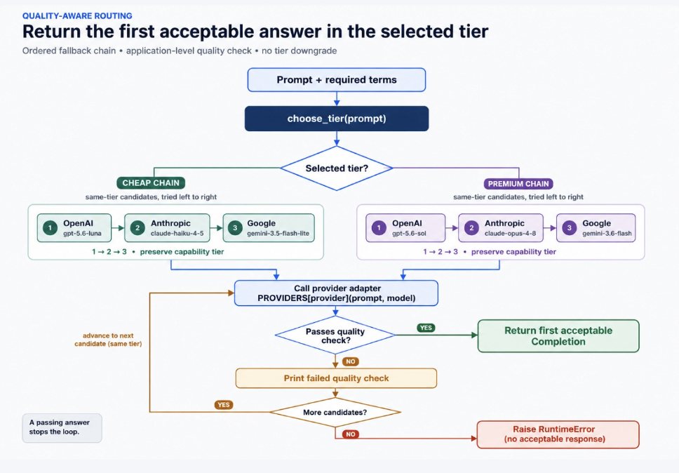

# model-router

Python model router for the OpenAI, Anthropic, and Google GenAI APIs.

The router picks a capability tier (cheap or premium) for each prompt, calls
the providers in that tier one after another, and returns the first answer
that passes an application-level quality check. Every call reports its token
usage and dollar cost.

## Setup

Create a `.env` file in this directory containing your API keys:

```
OPENAI_API_KEY=sk-...
ANTHROPIC_API_KEY=sk-ant-...
GEMINI_API_KEY=...
```

Each SDK reads its own variable (the Google client also accepts
`GOOGLE_API_KEY`). You need a key only for the providers you actually call.

`.env` is git-ignored — never commit it.

## Running

`uv run` does **not** load `.env` automatically, so you must pass `--env-file`:

```
uv run --env-file .env python -m model_router.main
```

Without the flag you get `openai.OpenAIError: Missing credentials`.

Alternatively, export the key for your shell session, or set `UV_ENV_FILE=.env`
so the flag is implied for every `uv run`:

```
export UV_ENV_FILE=.env
uv run python -m model_router.main
```

Note: `.vscode/settings.json` sets `python.terminal.useEnvFile`, but that only
applies to VS Code's integrated terminal — not to other terminals such as Warp.

Every module below with a demo runs the same way:

| Command | What it shows |
| --- | --- |
| `python -m model_router.main` | One prompt sent to each provider's cheap model, with tokens and cost |
| `python -m model_router.completion_gate` | The quality check on two hand-made answers (no API calls) |
| `python -m model_router.llm_completion_router` | Quality-aware routing over the demo requests |
| `python -m model_router.resilient` | The same routing, but surviving provider API errors |

## Code overview

All modules live in [src/model_router/](src/model_router/).

### `providers.py` — unified provider adapters

The shared layer that every other module builds on.

- **`Completion`** — a dataclass that normalizes a response from any provider:
  `text`, `provider`, `model`, `input_tokens`, `output_tokens`, and `cost`.
- **`PRICING`** — dollars per token (input and output) for each supported
  model.
- **`call_cost(model, input_tokens, output_tokens)`** — computes the cost of
  one call from `PRICING`.
- **`openai_client()`, `anthropic_client()`, `google_client()`** — lazily
  created, cached SDK clients. Importing the module needs no API keys or
  network access; a client is built only on its first call.
- **`generate_openai`, `generate_anthropic`, `generate_google`** — one adapter
  per provider. Each takes `(prompt, model)`, calls that provider's API in its
  own shape (OpenAI Responses API, Anthropic Messages API, Google
  `generate_content`), and returns a `Completion`. Provider quirks handled here:
  - Anthropic requires an explicit output limit, set by
    `ANTHROPIC_MAX_TOKENS = 1024` (256 cut longer answers short, so they
    failed the quality check).
  - Google bills "thinking" tokens as output, so they are added to the output
    token count before the cost is computed.
- **`PROVIDERS`** — maps a provider name (`"openai"`, `"anthropic"`,
  `"google"`) to its adapter, so callers can dispatch with
  `PROVIDERS[provider](prompt, model)`.

### `main.py` — provider comparison

Sends one prompt ("Give one practical tip for writing maintainable Python.")
to the cheap model of each provider and prints, per provider, the model,
input/output tokens, cost, and an 80-character preview of the answer. It is a
quick way to check that all three keys work and to compare cost.

### `completion_gate.py` — quality check

- **`passes_quality_check(result, required_terms)`** — returns `True` only if
  every required term appears in the answer text. The comparison is
  case-insensitive.

Run directly, it checks two hand-made `Completion` objects: one that passes
(`"PARIS"` matches "Paris") and one that fails (the answer mentions "lookup"
but not "writes").

### `llm_completion_router.py` — quality-aware routing



- **`choose_tier(prompt)`** — returns `"premium"` if the prompt contains any
  of the `HARD_KEYWORDS` (`analyze`, `debug`, `design`, `prove`, `refactor`,
  `strategize`) or is longer than 500 characters; otherwise `"cheap"`.
- **`FALLBACKS`** — the ordered candidate chain for each tier:

  | Order | Cheap tier | Premium tier |
  | --- | --- | --- |
  | 1 | OpenAI `gpt-5.6-luna` | OpenAI `gpt-5.6-sol` |
  | 2 | Anthropic `claude-haiku-4-5` | Anthropic `claude-opus-4-8` |
  | 3 | Google `gemini-3.5-flash-lite` | Google `gemini-3.6-flash` |

- **`route(prompt, required_terms)`** — the routing loop shown in the diagram:
  1. Choose the tier from the prompt.
  2. Call the candidates in that tier in order, through `PROVIDERS`.
  3. Return the first `Completion` that passes `passes_quality_check`. A
     passing answer stops the loop, so later (possibly more expensive)
     candidates are never called.
  4. If an answer fails, print a message and advance to the next candidate
     **in the same tier**. The router never downgrades from premium to cheap,
     so the capability level is preserved.
  5. If every candidate fails, raise `RuntimeError` (no acceptable response).
- **`DEMO_REQUESTS` / `run_demo(route_fn)`** — two sample requests: an easy
  one that routes to the cheap tier and must mention "paris", and an
  "Analyze…" prompt that routes to premium and must mention "lookup" and
  "writes". `run_demo` takes the routing function as a parameter, so the
  resilient router reuses it.

Note that this router does not catch exceptions: an API error from any
provider (missing key, rate limit, outage) aborts the whole request.

### `resilient.py` — routing that survives provider errors

A drop-in `route(prompt, required_terms)` with the same tier and fallback
logic, reusing `FALLBACKS`, `choose_tier`, and `run_demo`. The difference is
that an exception from a provider call is treated as one more failed
candidate: it is logged and the router moves on to the next model.

If every candidate fails, the `RuntimeError` lists each one with its reason
(API error or missing required terms) and is chained to the last API error, so
the original traceback is not lost.

### `__init__.py`

Package entry point for the `model-router` console script declared in
`pyproject.toml`. It currently only prints a greeting.
